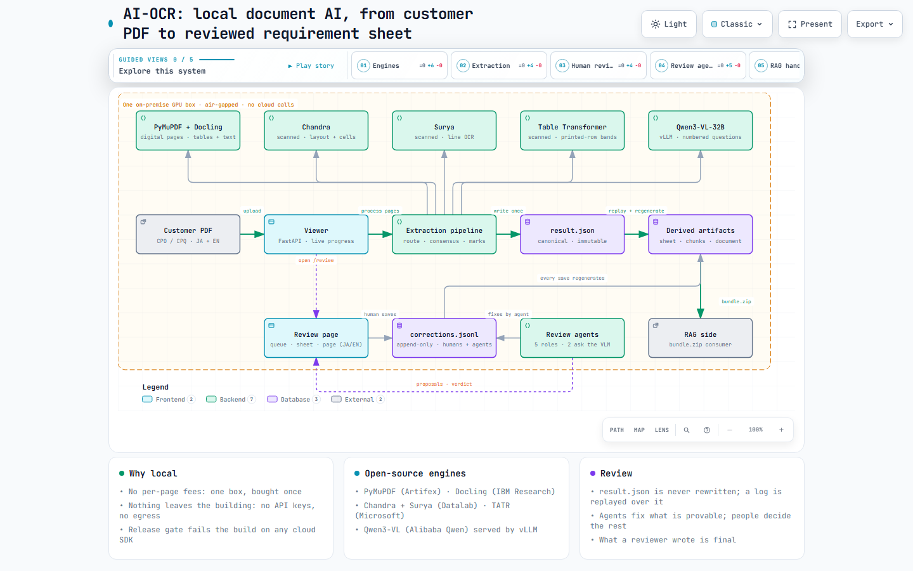

# AI-OCR — local document AI for engineering purchase orders

**Turns customer purchase orders and specification sheets — Japanese and English,
scanned or digital — into the structured requirement list a sales engineer quotes
from, with every value traceable to the exact spot on the page it came from.
It runs entirely on one on-premise GPU box: no cloud API, no per-page fees, and no
document ever leaves the building.**

> The source code is private. This page describes the system and credits the
> open-source projects it is built on.

<picture>
  <source media="(prefers-color-scheme: dark)" srcset="architecture-dark.png">
  
</picture>

---

## Why local instead of a cloud OCR service

Cloud document-AI services are convenient, but for confidential engineering
documents they mean sending every page to someone else's servers and paying for
every page, forever. This system is built to make that trade unnecessary:

| | Cloud document AI | AI-OCR, local |
|---|---|---|
| **Where the pages go** | Uploaded to a third-party service | Never leave one on-premise box; no API keys, no network egress |
| **Cost model** | Billed per page, every page | Fixed hardware cost, zero marginal cost per page |
| **Proof of privacy** | A contract | A release gate that fails the build if any cloud SDK or network path exists in the code |
| **Adapting to one customer's format** | Generic output to post-process | Emits the customer's own requirement-list format and conventions directly |
| **Traceability** | Varies by service | Every value carries its page, cell and pixel box, and every human or machine change is logged |

**Measured throughput on the box** (NVIDIA DGX Spark, GB10, 128 GB unified memory):
about **30 seconds per digital page** and about **3 minutes per scanned page**
(the document vision model dominates); the Table Transformer row pass adds
**4.6 seconds per scanned page** on the GPU. Everything runs unattended in the
background while the viewer streams progress.

We have not benchmarked accuracy against a paid service: doing so would mean
sending the confidential documents to one. A fair head-to-head needs a public,
non-confidential test set, and that is on the list.

## What the system does

| Stage | What happens |
|---|---|
| **Read every page twice** | Each page is routed by its text layer. Digital pages: PyMuPDF tables + Docling. Scanned pages: the Chandra document model + Surya line OCR. Where two independent witnesses agree, a cell is approved; where they disagree, both readings are kept. |
| **Recover the printed rows** | Scanners and table readers often fuse several printed rows into one. Microsoft's **Table Transformer** runs on every scanned table and records where the printed rows really are; fused rows are split back along those bands — conservatively, only when every text line clearly belongs to one row. |
| **Settle disagreements with evidence** | A local **Qwen3-VL** vision-language model, served by vLLM, answers short numbered questions about image crops — which options are circled, which rows pair, which values are struck through. It adjudicates; it never invents text. |
| **Recover structure** | Merged cells and row spans, title bands, stacked labels, sign-off margins, check-box lists, multi-item sheets with one column per valve. |
| **Build the requirement list** | The customer's exact delivery format — item number, requirement item, requirement specification — following their conventions: rows named by equipment tag, paired values split one per row, notes, legends and title blocks laid out the way their own lists are. |
| **Review without blocking** | A bilingual (JA/EN) review page shows the queue, the sheet and the page image side by side. Every edit is one line in an append-only log; the original extraction is never modified, and every output is regenerated from it plus the log. |
| **Let agents do most of the review** | Five local review agents check completeness, consistency and fidelity to the page, classify rows and verify the final bundle. Provable fixes apply themselves; judgement calls wait for a person's accept or reject. |
| **Hand off to retrieval (RAG)** | A semantic document, retrieval chunks with provenance and quality class, the Excel sheet and a verification report, bundled per document. |

## Results

Measured against a customer-supplied golden set — five real purchase orders with
the customer's own ideal requirement lists — using exact matching of both the item
and the specification:

- **98.9% of every character string on the pages reaches the requirement list.**
  Nothing is silently dropped; what can't be settled ships flagged for review.
- **95% of a digital data sheet's ideal list is reproduced exactly**, row for row.
- **Table Transformer row bands: +62% exactly-correct rows on a four-valve scanned
  specification sheet** (26 → 42), and 41% more of its strings captured (186 → 262),
  with no change on any other document.
- **Learning the customer's conventions** (tag naming, slash pairs, notes, legends,
  title blocks, multi-item layouts) raised exact matches across the golden set
  **six-fold** in one iteration.
- **Round-trip gate: 100%.** The golden truth replayed as reviewer corrections
  through the live review API reproduces the customer's list exactly — the review
  path loses nothing.

Scanned, heavily merged multi-column forms remain the hard case; every miss is
attributed to the stage that caused it (cell extraction vs. list assembly), so the
next improvement goes where it pays.

## Design principles

- **Measured is never overwritten by judged.** Engines measure, models adjudicate,
  people decide — and each keeps its own record.
- **Nothing is dropped silently.** Every string on the page reaches the list.
- **What a reviewer wrote is final.** No automatic step rewrites a row a person
  confirmed, edited or added.
- **Evaluated against the customer's own answers**, with ~980 automated tests on
  synthetic fixtures — no customer data in the repository, ever.

## Built on open source — credits

This system stands on the work of these projects and their authors. Thank you.

| Project | By | Role here | License |
|---|---|---|---|
| [PyMuPDF](https://github.com/pymupdf/PyMuPDF) | Artifex Software | PDF rendering, digital text layer and table geometry | AGPL-3.0 or Artifex commercial licence |
| [Docling](https://github.com/docling-project/docling) (+ docling-ibm-models) | IBM Research Zurich, Docling Project | Layout and table structure on digital pages | MIT (models: Apache-2.0 / CDLA-Permissive-2.0) |
| [Chandra](https://github.com/datalab-to/chandra) | Datalab (Vik Paruchuri and team) | Document vision model for scanned pages: layout and cell text | Code Apache-2.0; weights modified OpenRAIL-M |
| [Surya](https://github.com/datalab-to/surya) | Datalab (Vik Paruchuri and team) | Line-level OCR and geometry on scanned pages | Code Apache-2.0; weights modified OpenRAIL-M |
| [Table Transformer (TATR)](https://github.com/microsoft/table-transformer) | Microsoft (Brandon Smock et al.) | Printed-row bands on scanned tables | MIT |
| [Qwen3-VL](https://github.com/QwenLM/Qwen3-VL) | Qwen team, Alibaba Cloud | Vision-language adjudication and review agents | Apache-2.0 |
| [vLLM](https://github.com/vllm-project/vllm) | vLLM project | Serving the vision-language model locally | Apache-2.0 |
| [RapidOCR](https://github.com/RapidAI/RapidOCR) | RapidAI | Lightweight OCR fallback and line geometry | Apache-2.0 |
| [PyTorch](https://pytorch.org) · [Transformers](https://github.com/huggingface/transformers) · [timm](https://github.com/huggingface/pytorch-image-models) | PyTorch Foundation · Hugging Face (timm: Ross Wightman) | Model runtime | BSD-3-Clause · Apache-2.0 · Apache-2.0 |
| [FastAPI](https://github.com/fastapi/fastapi) · [Uvicorn](https://github.com/encode/uvicorn) | Sebastián Ramírez · Tom Christie / Encode | Viewer and review web app | MIT · BSD-3-Clause |
| [pydantic](https://github.com/pydantic/pydantic) · [openpyxl](https://openpyxl.readthedocs.io) · [RapidFuzz](https://github.com/rapidfuzz/RapidFuzz) · [jiwer](https://github.com/jitsi/jiwer) · [APTED](https://github.com/JoaoFelipe/apted) | Samuel Colvin et al. · openpyxl authors · Max Bachmann · Nik Vaessen · João Pimentel | Data model, Excel output, fuzzy matching, evaluation metrics | MIT · MIT · MIT · Apache-2.0 · MIT |

**Licence notes.** The Chandra and Surya *model weights* are released by Datalab
under a modified OpenRAIL-M licence that is free for research, personal use and
startups below a funding/revenue threshold; wider commercial deployment requires a
licence from Datalab. PyMuPDF is dual-licensed (AGPL-3.0 or commercial from
Artifex). Anyone reusing this design should check each licence for their own use.
